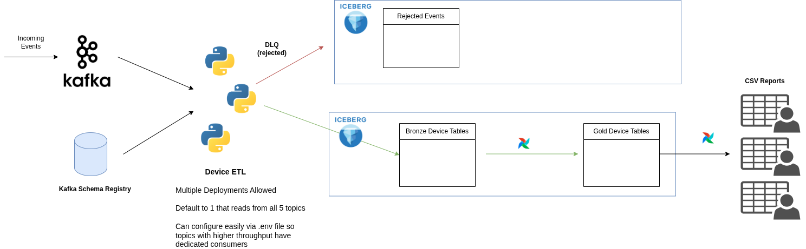

# Device Telemetry Analysis

## Table of Contents

- [Code Organization](#code-organization)
- [Quickstart](#quickstart)
- [Infrastructure Updates](#infrastructure-updates)
- [Data Flow](#data-flow)
- [Technical Design](#technical-design)
  - [I. Data](#i-data)
  - [II. Failures](#ii-failures)
  - [III. Scalability](#iii-scalability)
  - [IV. Observability](#iv-observability)
- [Airflow DAGs](#airflow-dags)
  - [lakehouse_quality](#lakehouse_quality)
  - [device_events_gold](#device_events_gold)
  - [iceberg_maintenance](#iceberg_maintenance)
  - [manual_sql_to_csv](#manual_sql_to_csv)
- [SQL Reports](#sql-reports)
- [Testing Strategy](#testing-strategy)
- [Production Considerations](#production-considerations)

---

### Code Organization:

| | Lakehouse Utility | Device ETL | Batch DAGs |
|---|---|---|---|
| **Path** | [`ingestion/ready-lakehouse-manager/`](ingestion/ready-lakehouse-manager/) | [`ingestion/device-ingestion/`](ingestion/device-ingestion/) | [`airflow/dags/`](airflow/dags/) |
| **Purpose** | Private package for managing lakehouse tables, schema definitions, Kafka topics, and data contracts. | ETL responsible for consuming device-level events from Kafka into Iceberg tables. | Generate optimized 'gold' level tables for analytics/dashboards/ML models. |
| **Reuse** | Used by services/ETLs to interact with the lakehouse, preventing duplication of common code (ex: schema validation). | Imports Lakehouse Utility for validation, Kafka + Iceberg I/O. | Compaction: Merges many small Parquet files from the streaming job into optimal sizes, reducing metadata overhead and improving query performance. |
| **How it works** | Schemas are defined in PyIceberg in [`models.py`](ingestion/ready-lakehouse-manager/src/ready_lakehouse_manager/iceberg/models.py) tracked in version control. CI/CD handles schema updates to environments. Ex: Change a PyIceberg definition and let CI/CD handle the changes. All DB changes tracked in git — no manual ALTER TABLE with untraceable history. | Implements OpenTelemetry traces to guide scaling and identify bottlenecks (ex: batch duration, slowest functions). Outputs to raw 'bronze' tables with possible duplicates. Services needing high-frequency data read from bronze, accepting the dedup trade-off. | Deduplicates event IDs from bronze using MERGE INTO. Cleans up old snapshots + orphan files. Runs on 5 minute interval (configurable). |
| **Also** | | | SQL Reports + Lakehouse Quality run in Airflow as well. |

## Quickstart

All commands run from the `solution/` directory.

```bash
# 1. Start the platform (Kafka, Nessie, Trino, Airflow, etc.)
docker compose -f ../docker-compose.yml -f docker-compose.yml up -d

# 2. Build images, seed S3 with reference data, and initialize the lakehouse
make deps

# 3. Start the ingestion pipeline
make start
```

After ~10 minutes of ingestion, all tables are queryable in Trino and reports can be exported via Airflow. All DAGs are unpaused on creation (`DAGS_ARE_PAUSED_AT_CREATION=false`) — the `device_events_gold` DAG begins running on its 5-minute schedule automatically, and the manual DAGs (`lakehouse_quality`, `iceberg_maintenance`, `manual_sql_to_csv`) are available to trigger immediately from the Airflow UI without needing to unpause them first.

**Late/delayed data:** The simulator produces intentionally delayed measurements that arrive after their measurement interval. No additional drain period is required — bronze tables accept events regardless of arrival order, and all analytical reports query full event history (no time window filter) so late-arriving data is automatically included in the next query. The gold layer deduplicates on `event_id`, not timestamp, so late duplicates are handled naturally. Results become more complete over time as delayed measurements arrive.

### Make Targets

| Command | What it does |
|---|---|
| `make deps` | Runs `build` → `seed-s3` → `init-lakehouse` in order. One command to go from zero to ready. |
| `make build` | Builds Docker images for the solution's two Python packages: `ready-lakehouse-manager` (shared library for Iceberg table management, schema definitions, Kafka deserialization, and batch writing) and `device-ingestion` (the streaming consumer). Each has its own Dockerfile that installs the package and its dependencies via `uv`. |
| `make seed-s3` | Uploads reference CSVs (sites, devices, device_dependencies, census_block_groups) and event contracts to S3 via the `s3-client` container. Requires Garage to be running. |
| `make init-lakehouse` | Runs the `lakehouse-init` one-time service (see below). Requires Nessie and Schema Registry to be healthy. |
| `make start` | Starts all services (`docker compose up -d`). |
| `make stop` | Stops all containers without removing volumes. Data is preserved for restart. |
| `make logs` | Tails logs for all services. Pass `SVC=device-ingestion` to tail a single service. |
| `make query` | Opens an interactive Trino CLI session. Pass `SQL="SELECT ..."` to run a single query. |
| `make test` | Runs unit tests for both `ready-lakehouse-manager` and `device-ingestion`. |
| `make clean` | Stops all containers, deletes all volumes, and removes solution images — full destructive reset. |

**Example commands:**

```bash
# Observe: check consumer lag and throughput
make logs SVC=device-ingestion

# Query: count ingested throughput events
make query SQL="SELECT COUNT(*) FROM iceberg.solution.throughput_events"

# Query: verify reference data loaded
make query SQL="SELECT COUNT(*) FROM iceberg.solution.sites"

# Test: run all unit tests
make test

# Stop without losing data, then restart later
make stop
make start
```

### Services

The solution adds four services on top of the supplied platform:

- **`schema-registry`** — Confluent Schema Registry. Manages JSON schemas for the five Kafka event topics. Enforces forward compatibility so producers can evolve schemas without breaking consumers.
- **`lakehouse-init`** — One-time startup job (`restart: "no"`). Creates all Iceberg tables in the `solution` namespace, loads the four reference CSVs from S3 into Iceberg, and registers event schemas with the Schema Registry. Runs idempotently — safe to re-run if it fails partway through.
- **`device-ingestion`** — Long-running streaming consumer. Subscribes to all five Kafka event topics, validates messages against the Schema Registry, and writes batches to bronze Iceberg tables. Failed records go to the `rejected_events` table or the `network.dlq` Kafka topic depending on the failure type.
- **`kafka-ui`** — Web UI for inspecting Kafka topics, messages, consumer lag, and schemas. Available at `http://localhost:8082`.

### Local Endpoints

| Service | URL | Credentials |
|---|---|---|
| Trino | `http://localhost:8080` | user: `readydata` |
| Airflow | `http://localhost:8081` | `airflow` / `airflow` |
| Kafka UI | `http://localhost:8082` | — |
| Schema Registry | `http://localhost:8083` | — |

## Infrastructure Updates

1. Kafka Schema Registry: manages schemas and enforces structure instead of relying on try/catch exceptions in code. Also enables schema evolution — producers download the latest schema on restart after a change.

2. Trino-Kafka Connector: makes Kafka queryable via SQL. Trino stitches together the data fabric — queries and joins across Kafka, Iceberg, and future data sources in one engine.

3. Kafka UI: inspect topics and messages.


## Data Flow




## Technical Design

### I. Data

**Medallion Architecture** — Two-tier medallion: bronze and gold. Bronze tables are raw, append-only ingests from Kafka — they preserve every event as-received, including duplicates. This keeps streaming write throughput high since there's no dedup overhead at ingest time. Gold tables are produced by a batch DAG (default runs every 5 mins) that runs `MERGE INTO` to deduplicate on `event_id`, producing a clean, query-optimized layer. Services needing real-time data read from bronze and accept the dedup trade-off. Dashboards, reports, and ML models read from gold.

**Temporal Partitioning** — All event tables are partitioned by day using `DayTransform` on `event_timestamp`. This gives Trino partition pruning on time-range queries — the most common access pattern for telemetry data (e.g., "last 24 hours", "last 7 days"). It also keeps partition cardinality manageable compared to hourly, and avoids the small-file problem you'd get with finer granularity at this event volume.

**Sort Order Optimization** — Tables are sorted by `device_id` (ASC) within each partition. This enables Parquet row group pruning — when a query filters on a specific device, Trino can skip row groups whose min/max stats don't overlap the target device ID. Without a sort order, device IDs would be scattered randomly across row groups, forcing full scans within each partition.

**Why No Spatial Types** — Iceberg v3 supports native `GEOMETRY`/`GEOGRAPHY` types with manifest-level bounding-box stats for spatial pruning, but Trino treats these columns as `VARBINARY` and cannot use the spatial metadata for file pruning — so adding a WKB geometry column would increase storage with no query benefit. The alternative — adding a geohash or H3 column as a secondary partition after time — introduces an over-partitioning problem: at this event volume and device count (hundreds of devices, single state), most time + geohash buckets would contain very few records, producing many tiny Parquet files and degrading performance rather than improving it. Geographic queries instead use pre-computed columns on the `sites` reference table (`distance_to_nearest_urban_area_km`, `inside_census_urban_area`) and join to events at query time. Spatial partitioning becomes justified when data density grows to millions of events across thousands of geographic regions — at that scale, Apache Sedona (Spark or Flink) would provide spatial operations backed by actual spatial indexing. Trino has its own geospatial functions (`ST_Distance`, `ST_Within`, etc.) but cannot leverage Iceberg's manifest-level spatial stats for file pruning — so spatial queries in Trino run as full scans regardless of the column type.


**Batch Writes** — The streaming consumer buffers records and flushes in max batches of 500 (configurable via `BATCH_SIZE`) rather than writing one record at a time. Explained in greater detail in the scalability section.
### II. Failures

Every failure scenario has an explicit outcome — no event is silently dropped, and Kafka offsets are never committed until all data (valid or rejected) has been durably persisted.

| Scenario | What happens | Data fate |
|---|---|---|
| **Schema/JSON validation fails** | `JsonDeserializer` rejects the message. Original payload is base64-encoded (lossless) with Kafka coordinates (partition, offset, timestamp) and written to the `rejected_events` Iceberg table. | Durably isolated in `rejected_events` with full Kafka lineage for replay. |
| **Transform/enrichment fails** | Record parsed JSON successfully but failed during field mapping. Same path as above — raw bytes are base64-encoded and written to `rejected_events`. | Durably isolated in `rejected_events`. |
| **Iceberg write fails (event tables)** | `BatchWriter.flush()` catches the exception and returns the failed batch in its `failures` list. Consumer sends the failed records to the `network.dlq` Kafka topic. The consumer does not commit offsets for this batch, but **continues polling**. If a subsequent batch succeeds and commits, the committed offset advances past the failed range — those messages now live exclusively in the DLQ. | Durably preserved in DLQ. The consumer does not stop — bad messages should not block processing of good ones. Recovery is handled externally (see DLQ Recovery below). |
| **Iceberg write fails (rejected_events table)** | Same as above — the failure is added to the `failures` list, sent to DLQ, and the consumer continues. | Preserved in DLQ. No data loss. |
| **DLQ produce fails** | The DLQ producer uses a delivery callback to verify each produce succeeded. If any delivery fails, a `RuntimeError` is raised — `_flush` never reaches `consumer.commit()`, so **offsets are not committed.** On the next poll cycle, the consumer re-reads the same messages and retries the full write → DLQ path. | No data loss. Messages remain in Kafka at their uncommitted offset. |
| **Consumer crashes/restarts** | `enable.auto.commit` is `false`. Offsets are only committed after a fully successful flush. On restart, the consumer resumes from the last committed offset. | Bronze tables are append-only and gold tables deduplicate on `event_id`, so reprocessing is safe. |

**Lossless Reject Preservation** — Rejected payloads are stored as base64-encoded bytes in `rejected_events.raw_value`, not decoded UTF-8. This preserves the exact original bytes regardless of encoding — no replacement characters, no truncation. Each rejected record also stores `kafka_topic`, `kafka_partition`, `kafka_offset`, and `kafka_timestamp` for full source lineage, enabling targeted replay from the exact Kafka position.

**Offset Commit Safety** — Kafka offsets are allowed to advance only after each consumed record has a durable destination in either Iceberg (preferred) or the dead-letter queue (Iceberg error). This prevents bad messages from slowing the main consumers with constant retries and generating back pressure. Valid records are persisted to their Iceberg event tables, invalid records are persisted to `rejected_events`, and batches that cannot be written to Iceberg are durably routed to `network.dlq`. A later successful Kafka commit may advance past records previously routed to the DLQ; those records are recovered from the DLQ rather than by rewinding the primary consumer, whose job is only to advance new records.

**DLQ Recovery and Observability Strategy** — The DLQ is therefore part of the durability path, not just an error log. Write failures due to Iceberg being down can be drained back into Iceberg after recovery using Kafka Connect with an Iceberg sink. Data or schema failures can be reviewed and replayed separately.

Consumers emit failure telemetry through OpenTelemetry rather than maintaining independent failure counters (ex: sys.exit() if fail_count > N). In production, the observability layer can aggregate those signals and instruct Kubernetes to scale the affected deployment pods down when failures become systemic — via tools like CloudWatch, CloudWatch Alarms, and Lambda functions and make the consumers as stateless as possible and recreating the observability layer.

Example: CloudWatch Alarm on DLQ Depth -> Lambda Function -> Scale failing consumer down. The last commited offset for that consumer matches last record written to DLQ or Iceberg. If it dies before either, the code won't commit the offset and reprocess the last record on restart.

**Gold Watermark Strategy (Production)** — The `device_events_gold` DAG currently uses a rolling window (`ingested_at > current_timestamp - INTERVAL '10' MINUTE`) to scope each MERGE INTO run. This works when the DAG runs on schedule, but if it is paused, fails, or restarts after an extended outage, any bronze data older than 10 minutes is missed — requiring a manual backfill. In production, the gold MERGE should track a *watermark* — the last committed bronze snapshot or offset it has already processed — so each run only merges new data since the previous successful write regardless of wall-clock gaps. Iceberg's snapshot metadata (e.g., `$snapshots.committed_at`) or a dedicated state table can serve as the watermark store; Airflow's dataset-aware scheduling could also trigger gold runs only when new bronze snapshots appear. I omitted this to keep the challenge scope minimal, but it is the first thing to add before production use.

### III. Scalability

**Kafka Poll Cycle** — The consumer calls `consume(num_messages=BATCH_SIZE, timeout=POLL_TIMEOUT)` in a loop. This returns *up to* `BATCH_SIZE` messages available within `POLL_TIMEOUT` — it does not wait for the buffer to fill. If only 30 messages arrive in the timeout window, 30 are returned. `BATCH_SIZE` is a ceiling per poll, not an accumulation threshold. Configurable via `BATCH_SIZE` (default 500) and `POLL_TIMEOUT` (default 1.0s).

**Iceberg Flush** — After every poll that returns messages, the consumer immediately flushes all queued records to Iceberg in a single append per table. There is no secondary buffer between Kafka and Iceberg — one poll cycle = one Iceberg write. A separate `FLUSH_INTERVAL` (default 5.0s) acts as a safety net: if a poll returns zero messages but records were queued from a prior cycle, they are flushed once the interval elapses. This prevents records from sitting in memory during low-throughput periods.

**Config-Driven Consumer Groups** — All tuning parameters are environment variables (`BATCH_SIZE`, `FLUSH_INTERVAL`, `POLL_TIMEOUT`, `KAFKA_TOPICS`, `KAFKA_GROUP_ID`), making scaling a deployment concern rather than a code change. Spin up a second instance with a different group ID and topic filter to isolate high-throughput topics onto dedicated consumers without touching the codebase.

**Synchronous Consumer Model** — The consumer uses synchronous polling rather than an async consumer with background threads. Each poll-process-flush cycle is a single thread with no concurrent state. This eliminates race conditions around batch assembly and Iceberg writes, and makes the processing model predictable: one message at a time, one flush at a time. Scaling horizontally (more consumer instances) is simpler and safer than scaling vertically with internal concurrency.

### IV. Observability

**OpenTelemetry Traces** — The streaming consumer is instrumented with OpenTelemetry spans across the poll-deserialize-write cycle. Traces capture batch duration, flush latency, and per-table write times, making it straightforward to identify bottlenecks — whether the consumer is slow because of Kafka polling, schema validation, or Iceberg commits. This drives informed scaling decisions rather than guessing where time is spent.

**Kafka UI for Lag Monitoring** — Consumer lag (the offset gap between the latest produced message and the consumer's current position) is visible in Kafka UI per topic and partition. Lag trending upward signals that the consumer can't keep up with the producer rate — the trigger for scaling out with additional consumer instances or isolating hot topics.

---

## Airflow DAGs

### `lakehouse_quality`

Validates reference data completeness, event-to-reference relationships, and dedup integrity across the lakehouse. Manually triggered with a configurable `lookback_days` parameter (default 7). All checks run in parallel and write results to the `quality_checks` Iceberg table.

**Output table: `quality_checks`**

| Column | Type | Description |
|---|---|---|
| `check_name` | `VARCHAR` | Identifier for the check (e.g., `orphan_devices`) |
| `check_type` | `VARCHAR` | `failure` or `warning` — severity level |
| `checked_at` | `TIMESTAMP` | When the check ran |
| `window_start` | `TIMESTAMP` | Start of the lookback window (NULL for reference-only checks) |
| `window_end` | `TIMESTAMP` | End of the lookback window (NULL for reference-only checks) |
| `violations` | `INTEGER` | Count of violations found |

**Checks:**

| Check | Type | What it catches |
|---|---|---|
| **Reference uniqueness** | | |
| `duplicate_site_ids` | failure | Duplicate `site_id` values in the `sites` table. Should be zero — each site must be unique. |
| `duplicate_device_ids` | failure | Duplicate `device_id` values in the `devices` table. Should be zero — each device must be unique. |
| `duplicate_census_geoids` | failure | Duplicate `block_group_geoid` values in `census_block_groups`. Should be zero. |
| `duplicate_dependencies` | failure | Duplicate `(downstream_device_id, upstream_device_id)` pairs in `device_dependencies`. |
| `empty_reference_tables` | failure | Any of the four reference tables (`sites`, `devices`, `device_dependencies`, `census_block_groups`) has zero rows. |
| **Reference relationships** | | |
| `orphan_devices` | failure | Devices referencing a `site_id` that doesn't exist in the `sites` table. Broken foreign key relationship. |
| `orphan_dependencies` | failure | Rows in `device_dependencies` where either `downstream_device_id` or `upstream_device_id` doesn't exist in `devices`. Broken dependency graph. |
| **Event quality** | | |
| `events_unknown_devices` | failure | Gold event records referencing a `device_id` not found in `devices`. Rolling 7-day window. |
| `events_unknown_sites` | failure | Gold event records referencing a `site_id` not found in `sites`. Rolling 7-day window. |
| `dedup_violations` | warning | Duplicate `event_id` values in any gold table within the lookback window. Should always be zero — a nonzero count means the `MERGE INTO` dedup DAG has a gap. |
| `rejected_summary` | warning | Total count of records in the `rejected_events` table within the lookback window. Tracks how many messages failed schema validation at ingest time. |

Reference checks (`orphan_devices`, `orphan_dependencies`) have no time window — they scan the full reference tables. Event checks (`events_unknown_devices`, `events_unknown_sites`, `dedup_violations`, `rejected_summary`) use the rolling `lookback_days` window scoped to `ingested_at` / `rejected_at`.

### `device_events_gold`

Promotes bronze event tables to deduplicated gold tables. Runs on a 5-minute schedule (configurable). For each of the 5 event types, executes a `MERGE INTO` that matches on `event_id` — new events are inserted, existing duplicates are skipped. This is the core of the medallion architecture: bronze is append-only for write speed, gold is deduplicated for query correctness.

### `iceberg_maintenance`

Manually triggered. For each gold table, first checks whether snapshots exist (skips empty tables), then inspects file metadata via the Iceberg `$files` metadata table — only compacts tables with a small-file problem (>10 files with avg size <10 MB). Uses `BranchSQLOperator` for conditional execution: tables that don't need compaction are skipped entirely. Destructive catalog or object cleanup (snapshot expiry, orphan file removal) is out of scope per challenge constraints and is not performed by this DAG.

### `manual_sql_to_csv`

Manually triggered. Accepts a single `report_name` parameter — the path relative to `sql/reports/` without the `.sql` extension (e.g., `5_underperforming_devices/underperforming_vs_peers`). Executes that one report against Trino and writes the result as a UTF-8 CSV to `solution/exports/`. Results are streamed via `fetchmany()` to avoid loading unbounded result sets into Airflow task memory. Null values are written as empty strings. Standard CSV quoting (`QUOTE_NONNUMERIC`) ensures stable headers and correct escaping.

**Safe failure behavior:** The exporter writes to a `.tmp` file first, then atomically renames it to `.csv` on success. If the query or fetch fails mid-stream, the `.tmp` file is cleaned up — no partial file is left with the final `.csv` name. Reruns with the same `run_id` overwrite the previous export (the filename includes the run ID). Collisions across different runs produce distinct files.

---

## SQL Reports

> Full report documentation — grains, output columns, thresholds, assumptions, and design rationale — is in [`sql/README.md`](sql/README.md).

| Perspective | File | Grain |
|---|---|---|
| 4 — Technology Statistics | `technology_throughput.sql` | One row per technology |
| 4 — Technology Statistics | `technology_connectivity.sql` | One row per technology |
| 5 — Underperforming Devices | `underperforming_vs_peers.sql` | One row per underperforming device |
| 6 — Provider Comparison | `advertised_vs_actual.sql` | One row per provider + technology |
| 7 — Geographic Patterns | `urban_vs_rural_performance.sql` | One row per area type (Urban/Rural) |
| 7 — Geographic Patterns | `distance_vs_performance.sql` | One row per distance bucket |
| 9 — Critical Infrastructure | `critical_infra_connectivity.sql` | One row per critical_infrastructure flag |
| 9 — Critical Infrastructure | `critical_infra_throughput.sql` | One row per critical_infrastructure flag |
| 9 — Critical Infrastructure | `critical_infra_device_health.sql` | One row per critical_infrastructure flag |
| 9 — Critical Infrastructure | `critical_infra_blast_radius.sql` | One row per incident |

**Why Perspective 9 dominates the report set:** The challenge asks us to understand how shared network dependencies affect multiple sites. Not all outages are equal — a router going down at a hospital or fire station has a fundamentally different blast radius than the same failure at a residential site. Critical infrastructure sites are flagged in the `sites` reference table via `critical_infrastructure = true`. I sliced this dimension across connectivity, throughput, device health, and incident blast radius to answer a single question from four angles: *are critical infrastructure sites getting worse service than the rest of the network, and when something breaks upstream, how far does the damage reach?* The blast radius query walks the `device_dependencies` graph one hop from the incident's originating device to count downstream sites — including how many are critical. Multi-hop transitive traversal would require a recursive CTE and is documented as a production improvement.

---

## Testing Strategy

Tests are split across the two packages with shared conventions: `conftest.py` for fixtures, flat test functions (no classes), no monkeypatching. Utility functions accept parameters rather than reading `os.environ` directly, so tests call the function with known inputs rather than patching global state.

**`ready-lakehouse-manager`** — Tests cover `BatchWriter` (queue behavior, flush returning success/failure counts, exception propagation from Iceberg writes) and `JsonDeserializer` (valid payloads, invalid JSON, schema violations producing rejects). Fixtures provide a `FakeTable` that simulates Iceberg append behavior and a pre-built `batch_writer` wired to it.

**`device-ingestion`** — Tests cover record flattening (the transform from nested Kafka JSON to flat Iceberg rows) and topic filtering (`_filter_topics` with various CSV inputs). Fixtures provide a `kafka_message` factory and sample records. Parametrized tests cover edge cases like empty strings, single topics, and unknown topic names.

---

## Production Considerations

Changes for production deployment, higher event volume, and broader geography:

**Avro + Snappy Compression** — The current pipeline uses JSON for Kafka serialization. Switching to Avro with Snappy compression would reduce message sizes significantly — Avro's binary encoding is typically 50-70% smaller than JSON, and Snappy adds fast compression with minimal CPU overhead. At high event volumes, this reduces Kafka broker disk usage, network bandwidth between producers and consumers, and S3 storage costs for the Iceberg tables. The Schema Registry already manages schemas, so the migration path is straightforward: update the serializer/deserializer to use Avro, and the registry handles compatibility.

**Spatial Data Types and Partitioning** — Site coordinates are currently stored as `latitude`/`longitude` float columns. As the network expands beyond Arkansas to more regions, casting these to geometry types and adding spatial partitioning (e.g., H3 hexagonal indexing or geohash-based partitioning) would dramatically improve spatial query performance. Queries like "all devices within 50 km of this site" currently require full scans; with spatial indexing they become partition-pruned lookups. Apache Sedona (available as a Spark library or Sedona-Flink for streaming) adds native spatial SQL support — `ST_Distance`, `ST_Within`, spatial joins — which would be valuable if the real-time use case grows beyond simple ETL into spatial analytics (e.g., real-time outage radius mapping, geographic SLA monitoring).

**Horizontal Scaling** — The consumer is already config-driven (`KAFKA_TOPICS`, `KAFKA_GROUP_ID`), so scaling is a deployment concern. In production, high-throughput topics (e.g., `network.throughput` if device counts grow 10x) would get dedicated consumer deployments with their own group ID, batch size, and flush interval tuned for that topic's volume. Kubernetes HPA on consumer lag would automate this.

**Secret Management** — The current setup uses hardcoded development credentials. Production must use a secret manager (Vault, AWS Secrets Manager) with short-lived credentials rotated automatically. The S3 credentials, Kafka SASL credentials, and Trino connection details would all come from the secret store rather than environment variables in docker-compose.

**Monitoring and Alerting** — OpenTelemetry traces are in place but not connected to an alerting backend. Production would export traces and metrics to a backend like Grafana/Prometheus with alerts on consumer lag thresholds, flush error rates, DLQ message rates, and Iceberg commit failures. The `lakehouse_quality` DAG results could also feed into alerting — a nonzero `dedup_violations` count should page someone.

